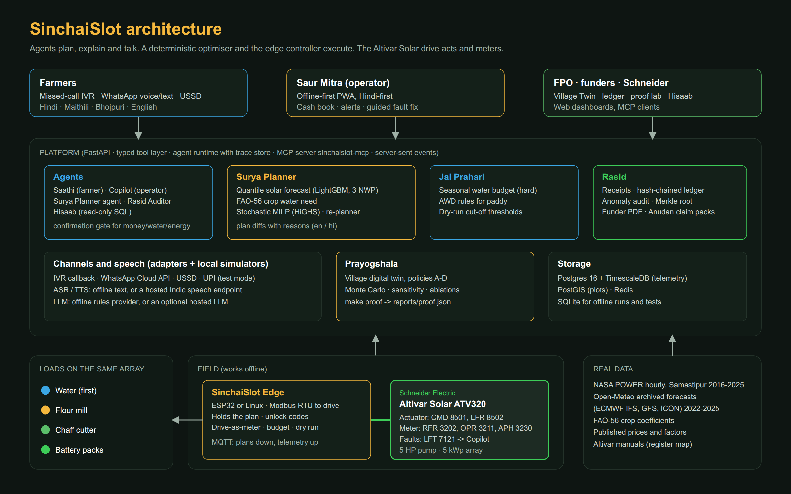

# SinchaiSlot

**Every shared solar pump in a Bihar village is a 5 kW power plant that sleeps most of the day.**
SinchaiSlot runs it as a village micro-utility: water first for the farmers who book it, then the flour
mill, chaff cutter and battery packs with the sun that is left, all inside the village's groundwater
budget. A Schneider Altivar Solar drive runs the pump and meters it; a forecast-driven optimiser plans
tomorrow's sun; a Hindi, Maithili and Bhojpuri voice agent lets a farmer book with a free missed call;
and every booking leaves a verified receipt of water, diesel and CO₂ avoided.

Schneider Electric Yuva Yodha Energy Tech Hackathon 2026 · Challenge 1: Sustainable Agriculture ·
Pilot geography: Samastipur district, Bihar.



## The proof (from `reports/proof.json`, generated 2026-11-23T03:41:02+05:30)
20 simulated years per policy (10 synthetic villages × held-out weather years 2024, 2025), real
NASA POWER sun and real archived forecasts. P50 with P10 to P90 across runs.

| Metric | SinchaiSlot (D) | Chakhaji-style first-come (B, primary baseline) | Oorja-style (C) |
|---|---|---|---|
| Solar kWh used per kWp per year | **1,163 (P10 1,148 to P90 1,183)** | 696 | 946 |
| Gain in solar used vs B | **+68%** (P10 +59% to P90 +74%) | | +23% vs C |
| Farmer price, solar water | **₹3.00/m³** | ₹5.38/m³ | ₹3.50/m³ (diesel ₹4.00) |
| Share of tenant water need met by solar | **27%** | 19% | |
| Fairness of access (Gini, lower is fairer) | **0.27** | 0.45 | |
| Diesel avoided per pump-year | **1,018 L** (2,692 kg CO₂) | 1,016 L | 1,175 L (no cap) |
| Seasons over the groundwater cap | **0% of runs** | 100% of runs | |
| Pump revenue per year | **₹164,018** (mill ₹50,730, battery packs ₹22,985) | ₹111,448 | |
| Saur Mitra income | **₹3,417/month** | | |

Owner-only use of the pump (policy A, context): 213 kWh/kWp/yr.

**Where the gain comes from, and where it does not (published on purpose).** Most of the gain over the
baseline comes from giving the pump's spare sun somewhere useful to go (mill, chaff cutter, battery packs). The
planner's own contribution is fairness of access and holding the groundwater cap, not extra sun:
- Against the same mill, cutter and battery packs run greedily, SinchaiSlot with the groundwater cap uses -1.0% solar energy (P10 -1.2% to P90 -0.4%): the planner does not add sun on its own; the extra loads do. Its gains are elsewhere: Gini of access 0.27 vs 0.39, and the cap held in 100% of runs vs 0%.
- Without the cap the planner uses +0.9% solar energy vs greedy dispatch and meets 31% of tenant need.
- By season (one village, first held-out year): +2.4% vs greedy loads in monsoon weeks, -0.9% in the rest of the year, when water demand fills the pump and the cap holds water back.
- The cap holds back 4,665 m3 of solar water a year, so SinchaiSlot avoids 14.2% less diesel than the per-m3 operator model without a cap; that water goes to diesel sellers on the same aquifer unless they share the cluster budget.
- The solar forecast adds +0.9% over planning on yesterday's sun; a perfect forecast would add +2.1% more.

**Forecast (held-out 2024, 2025).** Pinball loss 16.55 W/m² vs 25.56 (persistence) and
23.48 (climatology): 35% and 30% skill; P10-P90 coverage 75% over
8,838 daylight hours.

**Agent (Saathi).** First run on 204 held-out scripted conversations: 88.2% right,
76.4% of bookings completed, 0.0% wrong bookings (met pre-set thresholds: no).
After two fixes from that run (test set no longer strictly held-out): 98.5%, 100.0%,
0.0%. Median reply 5 ms offline. Real Indic ASR word error rate is not measured (no
hosted speech service configured); a simulated ASR-noise sweep is in `reports/evals.json`.

## Quickstart (no paid keys)
```bash
docker compose up --build          # web :3000, api :8000, Modbus drive simulator :5020, MQTT :1883
make seed                           # demo database (also done automatically on first start)
make demo                           # the scripted day in the terminal
make soak                           # the 13:40 cloud scenario 10 times, checked for identical results
make proof                          # regenerate reports/proof.json and figures (about 20-30 min)
make evals                          # agent evals, ASR robustness, optimiser benchmark
make test                           # Python tests + Playwright end-to-end and accessibility
```
Without Docker: `uv sync -p 3.12`, `make api`, and in `apps/web`: `pnpm install && pnpm dev`.

Demo: open http://localhost:3000, press **Run 2 March live** or **Jump to 13:45**. Screens: Village
Twin, Planner, Saathi phone (missed call → Maithili callback → press 1), Altivar drive (inject a fault,
follow the Copilot), Rasid ledger (verify the chain, build a claim pack), Prayogshala (all numbers),
Agent trace, Hisaab, Pump cluster (three pumps on a Sentinel-2 image, data health, move an overflow booking to a
neighbour), Pump Passport (`/passport/P1`, one-page PDF), Saur Mitra app (`/mitra`: soil card, pay after harvest).

## What is in the box
| Module | What it does | Where |
|---|---|---|
| Surya Planner | Quantile solar forecast (3 NWP sources + meta-model), FAO-56 demand, two-stage stochastic MILP, re-planner with reasons | `services/planner` |
| Jal Prahari | Seasonal groundwater budget (hard), AWD, dry-run cut-off | `services/jalprahari`, `services/edge` |
| Rasid / Anudan Meter | Receipts, hash chain, Merkle proofs, anomaly audit, funder PDF, claim packs | `services/rasid` |
| Schneider drive | Register map from Altivar manuals, Modbus adapter, drive simulator, drive-as-meter | `services/devices`, `docs/schneider` |
| SinchaiSlot Edge | Offline plan, unlock codes, metering, cut-offs (Python + ESP32 firmware) | `services/edge` |
| Saathi, Copilot, Hisaab, Auditor | Agents over typed tools with confirmation gate and trace store; MCP server | `services/api` |
| Channels and speech | IVR callback, WhatsApp, USSD, ASR/TTS, all with local simulators | `services/channels`, `services/speech` |
| Paani Khata | Diesel and electric sellers as overflow agents | `services/api` |
| Prayogshala | Village twin, policies A-D, ablations, Monte Carlo, sensitivity | `services/sim` |
| Cluster | Three pumps on one forecast, booking transfer within channel reach, data-health monitor | `services/api/sinchai_api/cluster.py`, `services/edge` |
| Pump Passport | Utilisation, uptime, faults, receipts, repayment record, scorecard, PDF | `services/rasid` |
| Harvest-linked repayment | Part now, rest after harvest at the KCC rate; limit grows with on-time repayment | `services/rasid` |
| Soil and water | Soil Health Card reader (texture sets TAW), borewell water-quality card, recharge pairing | `services/planner`, `services/jalprahari` |
| Bharat-VISTAAR handoff | Agronomy questions go to the national advisory line with the farm context | `services/channels` |
| Sentinel-2 crop map | NDVI phenology classes and a true-colour basemap from 30 clear scenes | `services/data` |
| Web | Story page, dashboards, phone simulator, Saur Mitra PWA | `apps/web` |

More: `docs/architecture.md`, `docs/agents.md`, `docs/optimiser.md`, `docs/data.md`, `docs/edge-protocol.md`,
`docs/decisions/`.

## Data labels
Weather and forecasts: **REAL** (NASA POWER 2016-2025; Open-Meteo archived ECMWF IFS, GFS, ICON 2022-2025).
Satellite: **REAL** Sentinel-2 L2A imagery (Jun 2024-May 2025); crop-season classes **DERIVED**, not validated
against field labels.
Village, bookings, pump and drive telemetry, ledger history: **SIMULATED**. Prices, factors, capex,
subsidy rules: **PUBLISHED** with source URLs in `packages/schemas/sinchai_schemas/constants.yaml`.
Modelling values not found in a publication are marked **ASSUMPTION** there (44 of them) and the
ones that move the headline are swept in the sensitivity analysis.

## UNVERIFIED (check before field use)
- Altivar registers with no published Modbus address: SPD, NPR, PVSA, LDCA, LITR, GPPT, GPTT, SLFV, PVLD, PVLT, PVCS, PCQ1-PCQ5, PCP1-PCP5, JAMS, DC_BUS_VOLTAGE, SOLAR_POWER, MPPT_STATE. They are never read over Modbus.
- Fault codes without a confirmed numeric value: SCF2, TSF.
- Schneider brand green value (`--se: #3DCD58`) used in the UI.
- Samastipur pilot block CGWB category (assumed Safe) and the 450 mm annual extraction cap.
- Maithili and Bhojpuri phrasing (native-speaker review pending, docs/decisions/0005).
- Real Indic ASR accuracy (no hosted speech service configured).
- Bharat-VISTAAR integration API (no public API found; the HTTP adapter is a placeholder shape).
- Recharge shaft yield and cost (CGWB planning norm from a Rajasthan block plan, not Bihar).
- Site coordinates: the configured point is Samastipur town; re-run the crop map on the pilot cluster.
