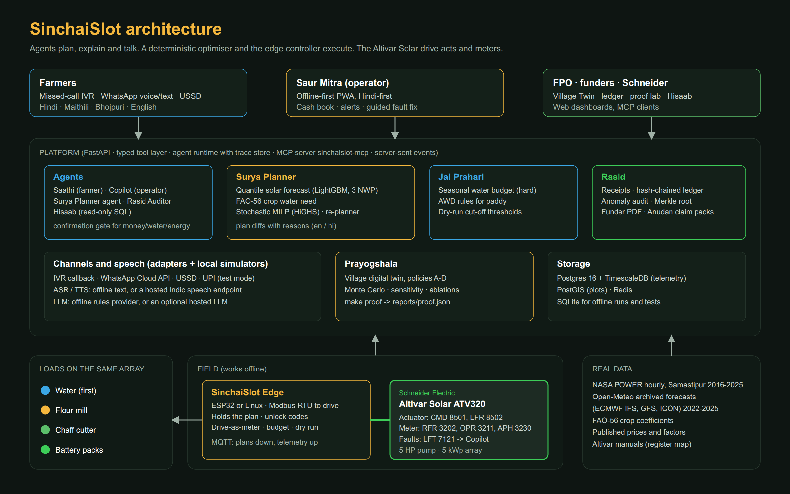

# Architecture

## Layers (EcoStruxure mapping)
| Layer | SinchaiSlot | Code |
|---|---|---|
| Connected products | Altivar Solar ATV320 drive on each pump: actuator (start/stop/speed) and meter (frequency, power, energy, faults) | `services/devices` |
| Edge control | SinchaiSlot Edge on ESP32 or Linux: holds the plan offline, unlock codes, drive-as-meter, budget and dry-run cut-off | `services/edge` (+ `firmware/`) |
| Apps, analytics, services | Surya Planner, Jal Prahari, Rasid, agents, channels, dashboards | `services/*`, `apps/web` |

## Control path (deterministic)
forecast (P10/P50/P90) + bookings + loads + budget → MILP (HiGHS) → plan → MQTT `sinchai/<pump>/plan`
→ edge controller → Modbus CMD/LFR to the drive → telemetry → drive-as-meter → `slot_completed` event →
Rasid receipt (hash-chained). No language model is on this path.

## Conversation path
channel adapter (IVR / WhatsApp / USSD / web) → Saathi → typed tools (role-checked, farmer-scoped) →
confirmation gate for money, water or energy → tool execution → trace store. The optional hosted LLM
only chooses tools and words; deterministic yes/no detection releases confirmed actions.

## Re-planning
Every 30 minutes or when the P50 forecast for the rest of the day moves by more than 15%; slots in
the next 60 minutes are frozen. Each change is explained in English and Hindi, and every affected
farmer is called with an honest message (if less water fits today, they are told and put first
tomorrow).

## Runs anywhere
`docker compose up` brings up TimescaleDB+PostGIS, Redis, Mosquitto, the API, a Modbus drive
simulator, an edge controller talking to it over Modbus TCP and MQTT, and the web app. Without Docker,
SQLite and in-process simulators are used. No paid key is needed for anything.
